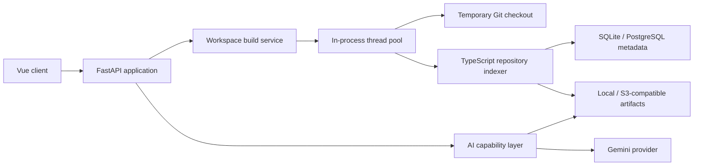
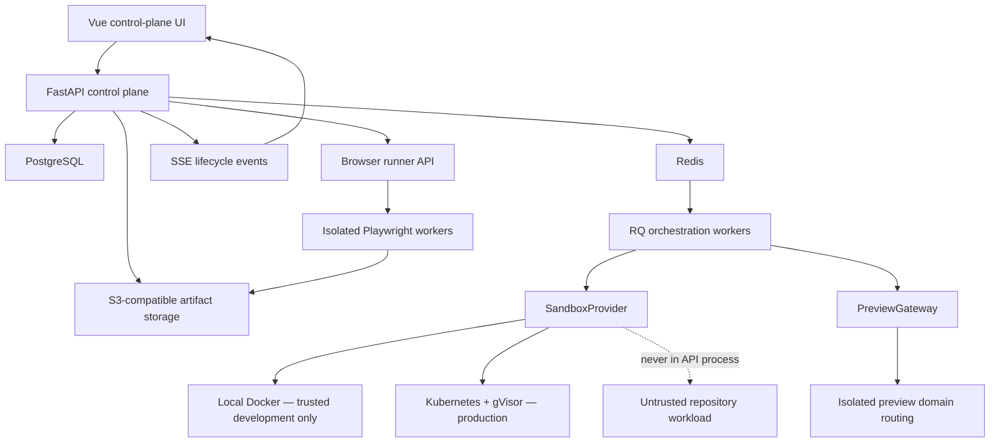

# Realtime Preview Lab — Phase 0 Assessment

## Scope of this increment

This increment designs the complete control-plane/execution-plane boundary and implements Phase 1 only: deterministic runtime-manifest analysis, strict validation, policy validation, persistence, API operations, and a review/approval UI. It does not execute repository commands.

Web applications are the only supported target. Native applications, physical devices, mobile emulators/simulators, device farms, arbitrary Kubernetes input, and arbitrary polyglot execution are out of scope.

## Existing repository assessment

TestForge is a compact monorepo:

- FastAPI owns HTTP APIs and constructs services in `backend/app/main.py`.
- Pydantic v2 models define API/domain payloads.
- SQLAlchemy provides SQLite development and PostgreSQL-compatible persistence.
- Repository indexing clones into a temporary checkout, parses JavaScript/TypeScript, persists a compressed repository artifact, verifies it, and removes the clone.
- The persisted artifact retains parsed source, package intelligence, documentation, and dependency relationships needed by chat and test generation.
- Background indexing currently uses an in-process `ThreadPoolExecutor` and durable build-stage rows.
- Gemini is isolated behind `AIProvider` and capability classes.
- Vue 3, TypeScript, Pinia, Axios, and the existing panel design system form the frontend.
- Workspace status is refreshed by polling; there is no existing SSE or WebSocket abstraction.
- There is no authentication/tenant boundary yet. `requested_by` therefore remains nullable until an auth hook exists.
- There is no queue, Redis, Alembic, Kubernetes/Helm, preview gateway, browser runner, or usable Docker Compose configuration yet.

## Files inspected

- Root and frontend READMEs, `.env` keys, `.gitignore`, `.gitattributes`, `docker-compose.yml`
- Python and Node package manifests and TypeScript/Vite configuration
- FastAPI routes and request/error patterns
- SQLAlchemy engine, rows, migrations, artifact store/codec, and workspace persistence
- Repository clone, indexing, parsing, graph, workspace-build, AI provider/capability, prompt, and context services
- Vue application/router, Axios service, Pinia stores, workspace shell, panels, and shared CSS
- Existing backend tests and frontend build scripts

## Patterns to preserve

1. Keep FastAPI as the authoritative control plane and route orchestration through services.
2. Keep repository execution out of request handlers. Phase 1 performs analysis only against the already-persisted, parsed workspace artifact.
3. Keep provider boundaries: manifest analysis, sandbox execution, gateway routing, and browser running are interfaces with environment-specific implementations.
4. Keep Pydantic models at API boundaries and SQLAlchemy for persistence.
5. Keep object storage for high-volume artifacts; database rows store metadata and references.
6. Add new APIs without changing existing workspace, chat, impact, or test-generation contracts.
7. Reuse the Vue workspace page and Pinia/Axios patterns rather than introducing a second frontend framework.

## Current architecture



## Target architecture



The control plane stores intent and lifecycle truth. Workers submit declarative requests to an execution plane. The FastAPI container never runs repository install/build/start commands, never receives the host Docker socket, and never supplies platform credentials to workloads.

## Lifecycle ownership

`PreviewLifecycleService` will be the only component allowed to mutate preview state. Route handlers request transitions; providers return observations; reconciliation corrects stale state. The proposed states are:

```text
DRAFT -> MANIFEST_READY -> QUEUED -> CLONING -> ANALYZING -> INSTALLING
-> BUILDING -> STARTING -> HEALTH_CHECKING -> READY -> STOPPING -> STOPPED
```

`FAILED` is reachable from active states, and `EXPIRED` is reached through cleanup when policy deadlines pass. Phase 1 ends at `MANIFEST_READY`; no preview lifecycle rows are executed yet.

## Phase delivery plan

### Phase 1 — runtime manifest

- Add versioned Pydantic manifest and analysis models.
- Persist one reviewed manifest per workspace with evidence, warnings, approval state, and optimistic versioning.
- Analyze deterministic signals already present in the workspace artifact: `package.json` intelligence, file inventory, documentation, configuration/lockfile names, and parsed environment references.
- Add a bounded analyzer interface. AI fallback remains an extension point and is not invoked unless deterministic required fields are unresolved.
- Validate safe commands as tokenized allowlisted package-manager operations; reject shell operators and dangerous configuration.
- Add analyze/get/update/approve APIs and a workspace Preview Lab panel.
- Add a deterministic Vite fixture and unit/API-persistence tests. No command executes.

### Phase 2 — trusted local execution

- Add Redis and RQ out-of-process workers.
- Implement lifecycle transition service, SSE, LocalDockerSandboxProvider, local routing, timeouts, logs, stop, expiry, and reconciliation.
- Display a prominent development-only warning. Docker alone is not an adequate hostile-code boundary.

### Phase 3 — Kubernetes production sandbox

- Implement Kubernetes Jobs/workloads/services/routes, gVisor fail-closed policy, quotas, network policies, restricted identities, signed access, Helm packaging, and reconciliation.

### Phase 4 — browser profiles and diagnostics

- Add isolated Playwright browser-runner service, capabilities, Chromium/Firefox/WebKit checks, curated emulated profiles, screenshots, console/page/network diagnostics, and bounded artifacts.

### Phase 5 — hardening

- Add auth/tenant quotas, rate limiting, audit events, idempotency, CSRF strategy, error middleware, OpenTelemetry, retention, dashboards, alerts, backup/runbook, load tests, and security review.

## File-level Phase 1 plan

- `backend/app/models/runtime_manifest_models.py`: strict versioned manifest and API models.
- `backend/app/services/runtime_manifest_analyzer.py`: interface and deterministic Node/Vite analyzer.
- `backend/app/services/runtime_manifest_policy.py`: safe-field and command policy.
- `backend/app/persistence/models.py`: durable runtime-manifest row.
- `backend/app/persistence/runtime_manifest_persistence_service.py`: workspace-scoped CRUD/approval.
- `backend/migrations/002_runtime_manifests.sql`: PostgreSQL migration.
- `backend/app/main.py`: non-breaking manifest endpoints.
- `frontend/src/types/api.ts`, `services/api.ts`: typed API contracts.
- `frontend/src/stores/preview.ts`: manifest analysis/review state.
- `frontend/src/components/RealtimePreviewLab.vue`, `WorkspaceView.vue`: Phase 1 UI.
- `backend/tests/fixtures/vite-basic`: deterministic no-network fixture signals.
- `backend/tests/test_runtime_manifest.py`: validation, inference, policy, and persistence tests.

## Risks and blockers

- The persisted repository artifact does not currently retain arbitrary non-code file contents. Phase 1 can identify lockfiles/configuration names and use package intelligence/documentation, but exact `.nvmrc`, `.env.example`, Dockerfile, and framework-config contents require a new safe analysis-artifact allowlist during a future workspace reindex enhancement.
- Existing workspaces may predate any future analysis-artifact schema. The analyzer must degrade gracefully and expose evidence gaps.
- There is no user identity, tenant, or authorization mechanism. Preview execution must not ship publicly before these hooks and quotas exist.
- `docker-compose.yml` is empty. Phase 2 must make local dependencies explicit.
- SQLAlchemy currently uses `create_all` plus hand-authored SQL. Phase 1 adds a migration, but production work should adopt Alembic before multiple release migrations diverge.
- No formatter or linter command is configured. Validation currently consists of Python unit tests, Vue TypeScript checking, Vite production build, and `git diff --check`.
- Kubernetes/gVisor availability, isolated preview DNS/TLS, and object-storage lifecycle rules are deployment prerequisites, not Phase 1 code assumptions.

## Compatibility

Phase 1 adds endpoints and UI only. Existing workspace identifiers, persistence artifacts, build APIs, AI queries, impact analysis, and test-generation contracts remain unchanged. No breaking migration is required.
